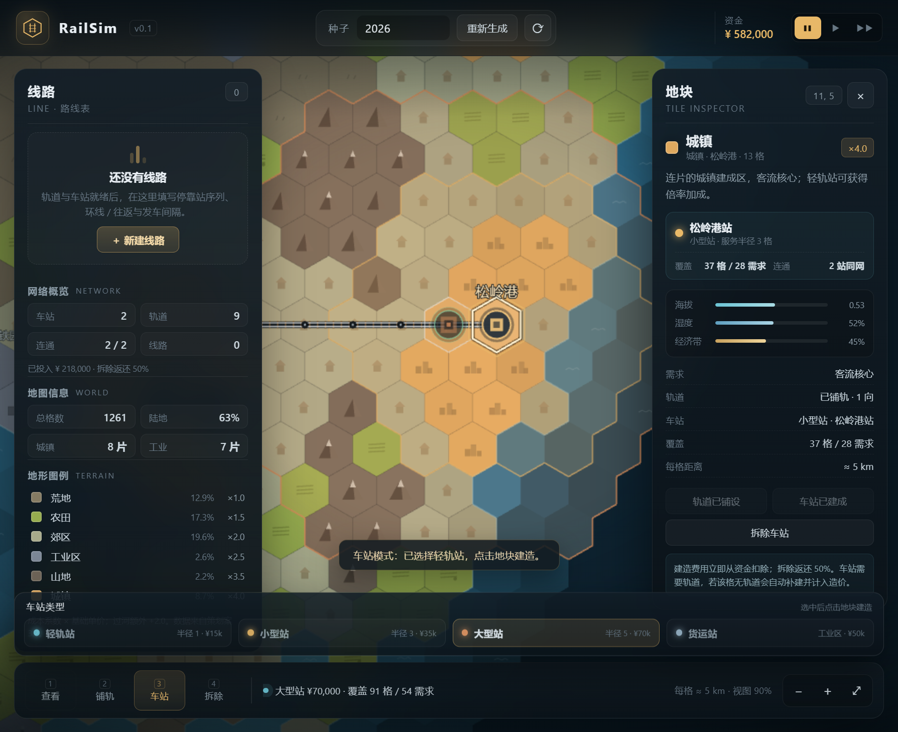
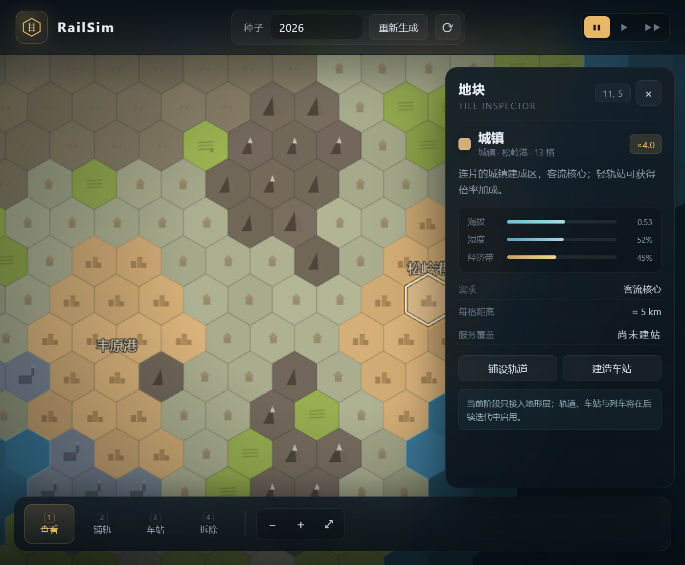

# RailSim · 铁路规划

网页端 2D 铁路模拟经营游戏。当前包含程序化地形、轨道与车站、车库、线路、列车与工业货运。

在六边形地图上铺轨、建站、创建线路、购买列车并配车，列车会沿 A* 路径运行。
客流、上下车、票款收入，以及工业区货单与自动接单的货运列车均已接入。


_线路、列车与客流：悬停可查看载客、收入与目的地。_



_车站工具：选择站型后点击地块建站。_


_车库：购买列车、查看库存、按线路配车。_



_地形：城镇、郊区、农田、工业、山地与水域。_

---

## 快速开始

```bash
npm install
npm run dev
```

打开 <http://127.0.0.1:5173>。首次进入会先显示开始界面；选择种子、地名文化、地图大小与偏移后点击「开始游戏」，新地图生成后会自动打开教程。地址栏会带上 `?seed=2026`，可以直接分享同一张地图。

也可以深链到某个地块：`?seed=2026&tile=11,5`。点击任意地块后，URL 会自动同步 `tile=q,r`。

| 命令 | 作用 |
|---|---|
| `npm run dev` | 启动本地服务 |
| `npm run build` | 类型检查 + 生产构建 |
| `npm run preview` | 预览生产构建 |
| `npm run inspect:map` | 在终端打印多个种子的地形占比、团块尺寸、海拔分位数 |
| `npm run typecheck` | 只做 TypeScript 类型检查 |

### 部署到 GitHub Pages

1. 推送到 `main`；
2. 打开仓库 **Settings → Pages → Build and deployment**，把 **Source** 设为 **GitHub Actions**；
3. 工作流会自动构建并发布 `dist`。

站点地址：`https://<用户名>.github.io/RailSim/`。

> 不能直接把仓库根目录设为 Pages 站点：根目录的 `index.html` 是 Vite 源码，浏览器无法运行 TypeScript。

### 开始界面

- **种子**：输入数字或文本种子，或点击 ⟳ 随机；右侧小图会实时预览地形。
- **地名文化**：中文 / English / 日本語 / Deutsch / Français，地名按所选语言生成并显示。
- **初始区域**：开局是一块约 1260 格的大区域，边缘为两侧斜边与顶底部横边，之后可以继续开拓相邻区域。
- **湿度偏移 / 海拔偏移**：在 −20% ~ +20% 之间调整，改变水域、山地与植被分布。
- 已有存档时提供「继续游戏」；「开始游戏」会用新地图覆盖当前存档，并自动打开教程。

## 操作

| 操作 | 说明 |
|---|---|
| 拖动地图 | 按住左键 / 右键拖动平移；左键单击（不拖动）执行当前工具 |
| 滚轮 | 以鼠标位置为锚点缩放 |
| 点击地块 | 查看模式下打开右侧地块检视；建造模式下执行铺轨 / 建站 / 拆除 / 路段编辑 |
| `1` / `2` / `3` / `4` / `5` | 查看 / 铺轨 / 车站 / 拆除 / 路段 |
| 车站工具 | 底部会出现站型选择条：轻轨站 / 小型站 / 大型站 / 货运站 |
| 路段工具 | 悬停相邻轨道节点之间，点击红色减号断开该段；点击绿色加号恢复。免费，不影响节点与覆盖 |
| `B` / 顶栏「车库」 | 打开车库：购买列车与货运列车、查看库存、给线路配车 / 卸车 |
| 顶栏「教程」 | 打开简明玩法教程，文末附 GitHub 仓库链接 |
| 线路卡片 | 悬停时在地图上用线路标识色高亮整条路线；点击「配车 / 编辑 / 删除」管理线路 |
| 线路编辑 | 填写名称、选择标识色与往返 / 环线，点击地图车站按顺序添加停靠；**拖动停靠行可调整顺序**，保存后自动计算 A* 路线 |
| 速度按钮 / `空格` | 暂停 / 1× / 2×：控制列车、货运列车、游戏时钟与客流 / 货单生成；空格在暂停与上一次速度之间切换 |
| 悬停车站 / 列车 / 货运列车 | 显示对应浮层：客流 / 载客 / 票款，或货运状态 / 货单 / 运费 |
| `F` | 适配全图 |
| `+` / `-` | 放大 / 缩小 |
| `WASD` / 方向键 | 平滑平移 |

> 种子相同 → 地图、城镇名称、河流走向完全相同。种子会同步写入 URL。
> 游戏进度会自动保存到浏览器 localStorage，刷新页面会恢复上次存档；开始界面的「开始游戏」会用新地图覆盖当前存档。
> 存在存档时以存档内记录的种子与地图设置（尺寸 / 地名文化 / 偏移）为准，URL 里的 `?seed=` 只在没有存档时用于首次生成。

---

## 轨道与车站

### 物理轨道

- 轨道以**六边形地块为节点**：相邻两个已铺轨地块自动连接成边，形成无向图。
- **线路段编辑**：相邻节点默认连通。选择「路段」工具，在共享边中点点击手柄即可**免费断开 / 恢复**该段；
  节点造价不变，覆盖也不变，只改变轨道图连通性。断开后该段不再渲染，连通分量、车站“同网”状态与未来列车 A* 立即使用新的图。
- 造价按格计算：`6,000 × 地块成本系数`。城镇 24,000，山地 30,000，水域桥梁 36,000。
- 轨道跨越水域时绘制桥面；单格孤立轨道绘制短轨桩。
- 每次铺轨 / 拆轨 / 剪接路段后重算连通分量；侧栏“连通”显示**同网车站数 / 总车站数**。
- 车站必须落在轨道节点上；若建站时脚下没有轨道，会**自动补一格轨道**并计入造价。

### 车站

| 车站 | 造价 | 覆盖 |
|---|---|---|
| 轻轨站 | ¥ 15,000 | 半径 1 格 |
| 小型站 | ¥ 35,000 | 半径 2 格 |
| 大型站 | ¥ 70,000 | 半径 3 格 |
| 货运站 | ¥ 50,000 | 所在 / 紧邻的连片工业区（自动生成货单） |

- 车站造价为固定值，自动补轨的轨道费按地块另行计算。
- 车站不再自己产生客流，只作为乘客上下车与换乘的节点；需求由每个非荒野地块独立生成，详见「客流与票款」。
- 经济带仍用于地形生成，但不再影响客流。
- 车站覆盖写入每格的 `servedBy`，需求统计会排除水域、山地与荒地。
- 覆盖显示分三层：所有车站的常驻弱覆盖、查看模式下选中车站的高亮描边、建站工具下的落点预览。
- 水域不能建站；货运站必须位于工业区或紧邻工业区。
- 拆除返还 **50%** 建造费。拆除车站后轨道保留；车站脚下的轨道不能直接拆除（需先拆站）。
- “连通”只统计与其他车站共享轨道分量的车站；孤立车站会显示红色描边和“孤立 · 仅本站”。

### 资金

- 初始资金 **¥ 500,000**，顶栏实时显示；资金不足时报价会给出原因并禁用按钮。
- 开始界面的「开始游戏」会清空轨道 / 车站 / 线路 / 列车 / 客流，并把资金重置为 500,000；界面会提示将覆盖当前存档。
- 列车购置与铺轨 / 建站立即扣款；车票收入在乘客到站时实时入账，显示在顶栏与左侧“今日 +¥”中。
- **运行成本**：客运列车每运行 **1 格（5 km）** 扣 **¥40**，货运列车每运行 1 格扣 **¥20**。成本按实际行驶距离连续扣除，停站、卸货、隐藏时不计费。
- 左侧网络概览会同时显示“今日收入”和“今日成本”；悬停列车 / 货运列车可查看各自今日与累计运行成本。

### 开拓新区域

- 整张初始地图被视为宏观地图上的**一块区域**。点击顶栏「开拓」后回到地图，现有区域周围会显示黄色六边形框，表示所有可开拓的相邻区域。
- 点击任意黄色六边形选中该区域，随后弹出确认窗口；确认后才会扣除费用并生成新区域。按 `Esc` 或取消可以退出选区。
- 每块区域约 1260 格，包含与初始地图同量级的地形、城镇、工业区、湖泊与河流。
- 第一次开拓 **¥1,000,000**，之后每次费用翻倍（2,000,000 / 4,000,000 / 8,000,000…）。
- 区域之间通过六边形边界自然衔接，旧地块不会被改写；地图外没有固定海洋边界。
- 开拓时会以新区域为中心播放金色六边形扩散波，并自动调整相机以容纳整张地图。
- 新区域地形由种子和区域坐标确定；读档时按保存的区域顺序重放，保证地形、团块与地名一致。
- 已解锁区域列表写入存档；地图可以持续向外扩展，没有固定上限。

### 存档

- 游戏进度自动保存到浏览器 **localStorage**（键名 `railsim.save.v3`），每 2.5 秒写入一次，并在切换标签页 / 关闭页面时补写。
- 存档内容包括：地图种子与地图设置（已解锁区域列表、地名文化、湿度 / 海拔偏移）、资金、轨道、车站、连通断开段、线路、列车与载客、候车乘客、货运订单 / 货运列车、游戏日期与今日 / 累计收支、随机数状态。
- 刷新页面会按存档种子重建地图并恢复全部进度，启动后会提示“已恢复上次存档 · 第 X 日 HH:MM”。
- 开始界面的「开始游戏」会删除旧存档并写入新地图的初始状态；「继续游戏」保留当前存档。
- 存档只保存在本机浏览器中；清除浏览器站点数据、使用隐私模式或更换浏览器都会丢失进度（目前不支持导出 / 导入存档文件）。
- 当前存档版本为 **3**（平滑边缘区域地图）；版本 1 / 2 的旧存档无法兼容，会按新地图重新开始。

### 车库与列车

- 点击顶栏「车库」或按 `B` 打开车库；购买后列车进入库存，购买立即扣款。
- 库存列车可以在车库里选择目标线路配车，也可以从线路卡片的「配车」进入；已配车列车可按线路卸下退回库存。
- 列车按线路分组显示，线路删除时其列车自动退回库存。
- 车库同时出售**货运列车**：¥28,000/列，1 单/趟，不需要线路或配车，有货单时沿已有铁轨自动接单；可以购买多列并行运输。
- 「购买列车」栏现在统一包含 3 种旅客列车和 1 张货运列车卡片；「库存列车」列表也会合并显示未分配旅客列车与所有货运列车（货运列车标记为自动接单，不提供线路选择）。

| 车型 | 编组 | 造价 | 速度 | 定员（4 人/节） |
|---|---|---|---|---|
| 通勤列车 | 2 节 | ¥ 60,000 | 标准 | 8 |
| 快速列车 | 3 节 | ¥ 95,000 | 较快 | 12 |
| 重载列车 | 4 节 | ¥ 140,000 | 较慢 | 16 |

### 线路

- 左侧「新建线路」：填写名称、选择标识色、往返 / 环线，并按需勾选「平均发车」，然后**点击地图上的车站**按顺序加入停靠。
- **平均发车**：勾选后，多辆列车会按线路周期均匀分配间隔；如果某列车与前车的间隔低于理想间隔的 85%，它会在当前车站等待，直到间隔拉开后再发车。等待中的列车状态显示为「等间隔待发」，线路卡片带「平均」标记。单列车线路不受影响。
- 停靠列表支持**拖动排序**：按住任意停靠行拖到目标位置，序号与路线顺序会即时更新；保存时按新顺序重算 A* 路径。
- **修改运行图时列车不会瞬移，也不会清空车上乘客**：列车先沿旧图行驶到下一站，再沿现有轨道返回新运行图的首站，接回后再继续按新图运行。回送途中只下客，不办理上客；到首站后车上乘客会自动重新计算剩余路线。改线瞬间会保留当前速度与车尾位置，避免车厢挤成一团或急停。
- 保存至少需要 2 个停靠站，且相邻停靠之间必须有连通的轨道；站间路径由 `RailNetwork.findPath` 做 A*（只走启用的连接段）。
- 货运站不能作为客运线路停靠站；线路编辑时只高亮可选的客运站。
- 线路卡片显示标识色、状态、停靠顺序与列车数。**鼠标悬停线路卡片时，地图会用线路颜色高亮整条路线和停靠站。**
- 线路卡片提供「配车 / 编辑 / 删除」；删除线路时列车退回库存。
- 轨道、车站或连接段变化后自动重算所有线路：路径断开 → 线路标红「断开」，列车停驶（当前不绘制）；修复后自动恢复。
- 列车沿线路折线移动，**每个停靠站都会停车**：进站前按制动曲线减速，停稳后停站 1.8 秒，再加速起步；往返线在两端折返，环线首尾相接。
- 列车在地图上显示为**线路标识色的一串长条车厢**，车厢数等于编组节数；车头带白色方向条。
- 每节车厢定员 **4 人**，车内用最多 4 个乘客类型色圆点表示实际乘客；乘客优先分配到载客最少的车厢。
- 顶部速度按钮暂停 / 1× / 2× 控制列车推进（停站读秒也随倍率变化）；按 `空格` 可快速暂停 / 继续，继续时恢复上一次速度。

### 客流与票款

- **游戏时钟**：1 实在秒 = 30 游戏分钟，第 1 日 08:00 开局；顶栏日期实时更新，跨过午夜会重置“今日”统计。
- **个体乘客**：每位乘客都是独立对象，持有出发地块、目的站、上车站、类型、预算、预计成本、路线段、状态与车厢号。乘客不是聚合计数，网络变化时会逐个重新寻路。
- **生成**：地图上的每个非荒野地块都是潜在需求节点，按地块类型独立生成乘客，不会因为多个车站覆盖同一格而重复产生。只有落在客运车站服务范围内的出发地块才会生成乘客：

| 地块类型 | 期望生成 / 天 |
|---|---:|
| 城镇 | 0.6 |
| 工业区 | 0.3 |
| 郊区 | 0.2 |
| 农田 | 0.05 |

- 每小时检查一次，每个地块按「日期望 / 24 × 线网加成」的概率生成；单站候车上限 160 人。
- **线网加成**：每个车站所在的可达线网（通过已配车线路连通的客运站集合）会放大客流。把线网内所有车站服务地块去重后，按城镇 3.0 / 工业区 1.5 / 郊区 1.0 / 农田 0.5 求和，系数为 `1 + 总和 × 0.001`。可达地点越多，选择铁路出行的人越多；小网络不会因此被削减。车站悬停卡片与右侧车站设施卡片都会显示该系数。
- **乘客类型**：地块会按类型生成不同乘客。城镇更容易产生旅游乘客，工业区更容易产生商务乘客；通勤乘客主要来自郊区、城镇与农田。
- **目的站**：从当前上车站出发，在线网内**所有实际可达的客运站**中按权重随机选择。基础权重 = `1 + 服务格数 × 0.02`，覆盖越大的车站吸引力略高。
- **类型偏好**：通勤倾向较近的目的站（距离越远权重越低）；旅游倾向较远的目的站（距离越远权重越高）；商务倾向服务范围内城镇 / 工业地块较多的目的站。
- **旅游最短距离**：旅游乘客只接受直线距离至少 **8 格（约 40 km）** 的目的站；如果线网里没有足够远的地方，该乘客不会生成。城镇地块的旅游生成权重为 30%。
- **上下车站**：乘客从出发地块步行到最近的客运车站上车；终点直接是目的站，不再额外产生目的地步行段。货运站不参与。
- **独立寻路**：在「线路 × 车站」服务图上做 Dijkstra / A*。乘车边权重为预计游戏分钟，换乘边固定 **18 分钟**；只考虑状态正常且已配车的线路。环线只允许沿运行方向前进，往返线可双向。
- **预算与成本**：通勤 / 旅游 / 商务三种乘客的基础预算分别为 150 / 220 / 180 游戏分钟，再乘 0.8~1.4 随机系数；并按出发地块到目的站的**直线距离**追加路程预算。总成本 = 出发地步行 + 8 分钟候车 + 各段乘车 + 换乘惩罚；超过预算的乘客不会生成。
- **状态机**：`WAITING`（站内候车）→ `ON_TRAIN`（车上）→ `TRANSFERRING`（换乘候车）→ `ARRIVED`；下车站被拆除时 `GAVE_UP`。轨道 / 线路 / 车站变化后，所有 `WAITING` 与 `TRANSFERRING` 乘客逐个重新寻路；暂时无路线时留在站内等待（不会立刻消失），线路恢复后自动恢复行程。车上乘客在改线 / 删线 / 断线 / 回库时退回出发站并重新寻路。
- **上下车**：列车到站先下客；到达目的站结算全部累计票款，需要换乘的乘客进入站内等待下一段线路。停站结束、确定发车方向后，按各自路线与车厢空位上客。
- **票价**：`(¥24 起步价 + ¥12/公里) × (车型速度 / 46)`，每段上车时累计，到站时一次性计入资金和“今日收入”。换乘乘客的票款为各段之和。
- 1 格 = 5 km：通勤列车 10 km 约 ¥144，快速列车约 ¥200，重载列车约 ¥113。
- **地图表现**：
  - 车站图标上方用候车圆点表示人数：1~5 人显示对应数量，超过 5 人显示 5 个圆点 + 数字；圆点按乘客类型着色（通勤青 / 旅游金 / 商务蓝）。
  - 每节车厢内最多显示 4 个乘客圆点，同样按类型着色。
  - 车站图标绘制在列车之上；列车车厢为“长度 70% × 宽度 50%”的长条。
  - 乘客到站结算票款时，车站上方会浮出 `+¥N` 收入跳字；多人同站同时下车会合并显示金额与人数（如 `+¥576 / 4 人下车`），向上飘动并淡出。
- **悬停信息**：
  - 车站：站名 / 类型、覆盖格数、候车 / 换乘人数、乘客类型构成、今日上车 / 送达、目的地分布、所属线路。
  - 列车：线路、状态（运行中 / 停站中 / 线路断开）、载客 / 定员、乘客类型构成、各车厢载客（如 `4/4 · 2/4`）、下一站、今日送达与收入、目的地分布。
  - 货运列车：状态（前往取货 / 装货中 / 送货中 / 卸货中 / 待命）、是否载货、货单起点 / 终点、货物件数与运费、今日送达 / 收入。

### 货运列车与货单

- 玩家建造的**货运站**服务于所属工业区；货单由**工业区**生成，而不是由单个货站各自高频生成。
- 地图上至少需要 **2 个有货运站的工业区**才会产生货单；目的地随机选择**另一个工业区**，不会以自己为目的地。
- 每个工业区每 **游戏小时** 有 **1%** 概率生成一张货单（平均约 0.24 张/天）；首次启用时随机相位到下一个整点，避免所有工业区同时生成。同一工业区有多个货站时共享这一次判定；全图同时最多 48 张货单。
- 每张货单携带 1–3 件货物，运费在 **¥500–¥1000** 之间随机，与距离无关，送达时计入资金。
- 车库可购买**货运列车**，货运列车**不属于任何线路**，也不占用旅客列车库存。购买后无需指定线路，有货单时会自动接单。
- 货运列车**必须沿铁轨行驶**：它使用轨道图 A*（只走启用连接）从当前位置前往货单起点，再前往目的地。没有轨道连通时不会接单。
- 货运列车行为：
  1. 有货单时，隐藏的列车会在**上一次送货终点**重新出现，然后沿铁轨前往货单起点；
  2. 第一次接单的新车没有历史终点，直接在货单起点生成并装货；
  3. 装货 1.2 秒后变为载货状态，沿铁轨前往目的地；卸货 1.2 秒后结算运费；
  4. 送达后如果还有轨道可达的待运货单，会立刻去接下一单；如果没有任何其他货单，就从地图上隐藏，等待下一次货单。
- 地图表现为**灰色单节货运车厢**：空车中部是深色货槽，载货时变为暖色货箱，车头白色短线指示方向。悬停可查看货单详情。
- 货运站图标上方会用与货车载货箱同尺寸、同颜色的**暖色货箱**显示待运货单；多个货单垂直堆叠，最多显示 3 个。
- 货运站悬停会显示待运货单数；货运列车送达时目的地会浮出 `+¥N / 货单送达` 收入跳字。
- 删除货运站时，相关货单会清理，在途货运列车放弃当前货单并隐藏。
- 剪断 / 拆除铁轨导致剩余路径不可走时，在途货运列车会重新寻路；找不到替代路线时放弃当前货单，订单退回等待。

---

## 功能

### 1. 页面框架

- **顶栏**：品牌、资金、游戏日期与时钟、教程入口、车库入口、暂停 / 1× / 2×。
- **左侧栏**：线路列表 / 线路编辑器、网络概览（车站 / 轨道 / 列车 / 线路 + 连通、库存、今日收入与成本）、地图统计、地形图例。
- **右侧栏**：地块检视面板，显示地形、连片团块、建造成本、轨道与车站状态、车站覆盖 / 连通信息，以及铺轨 / 建站 / 拆除操作。
- **底部工具坞**：查看 / 铺轨 / 车站 / 拆除 / 路段、悬停读数、缩放与适配全图；车站模式下展开站型选择条。
- **车库弹窗**：购买列车、库存、按线路编组与卸车；购买货运列车与查看自动接单车队。
- **教程弹窗**：顶栏「教程」打开简明玩法说明，文末附 GitHub 仓库链接。
- **地图浮层**：悬停车站 / 列车 / 货运列车显示实时客流、载客、货单与票款收入。
- **货运表现**：灰色单节货运车厢，空车 / 载货有明确视觉区分；需沿铁轨行驶，货单运费到站跳字。
- **客流表现**：车站上方候车圆点（超过 5 人显示数字）与车厢内乘客圆点。
- **反馈**：启动遮罩、Toast、快捷键、窄屏响应式（侧栏变浮层，资金仍保留在顶栏）。
- **存档**：localStorage 自动存档与刷新恢复；开始界面的新游戏会覆盖存档。
- 个体乘客、独立寻路、预算过滤、换乘与票款已接入。

### 2. 地形生成（三层管线）

`src/game/mapgen.ts` 是纯函数式管线，输入种子，输出 `World`：

1. **宏观噪声**：Perlin 海拔 + 山脊；另一组噪声生成湿度与低频经济带；湖泊噪声在地势较低处形成大湖，地图不再有固定的海洋边界。
2. **区域划分**：地图被划分为互不重叠的大六边形区域，区域格间距 36 格，单块区域约 1260 格；区域网格相对地块网格旋转 30°，因此边缘是两侧斜边 + 顶底部横边，初始地图就是 (0,0) 区域。
3. **连片修正**：海岸平滑；城镇强制 8~20 格；工业 3~8 格；城镇外围晕染郊区 / 农田；生成可复现地名。
4. **局部细化**：从湖泊边缘向高处逆流雕刻 1 格宽的长河，避开城镇与工业团块，河岸提升湿度。

**地形配比**：农田优先级高于郊区；低经济带（`econ < 0.55`）且湿度 > 0.46 的地块也会归为农田，城镇外围二、三圈提高农田概率、降低郊区概率。以种子 2026 为例，农田约 26%、郊区约 12%。

生成参数：每格 5 km、海平面 0.34；单块区域约 1260 格，最多 4 条河。新区域使用同一套全局噪声，因此与相邻区域的地形连续；每次开拓增加一块完整区域，地图尺寸随区域数量持续增长。

### 3. 地图与网络渲染

- Phaser 4 + WebGL 绘制地形明暗、海岸线、团块轮廓、地形图标与恒定屏幕尺寸的地名标签。
- 轨道层：双钢轨 + 枕木 + 桥面；站点 / 道岔节点；缩放时轨道与车站保持稳定的屏幕尺寸。
- 路段层：悬停共享边显示圆形手柄；红色减号 = 断开，绿色加号 = 恢复，断开状态用绿色虚线预览。
- 车站层：轻轨圆标、小型方标、大型双层方标、货运集装箱标；孤立车站红色描边。车站图标位于列车之上。
- 覆盖层：常驻弱覆盖 + 选中高亮 + 建站预览；覆盖率与需求格数在 Dock 和检视面板中同步显示。
- 线路层：悬停线路卡片时沿 A* 路径用线路色绘制光晕 / 核心线与停靠站外圈；断线显示红色虚线。
- 列车层：按线路颜色绘制长条车厢（长度 70% × 宽度 50%），车厢内最多 4 个乘客圆点；车头有白色方向条，沿折线移动 / 折返。
- 客流层：车站上方候车圆点（>5 人显示数字），车站图标位于列车之上。
- 货运列车层：灰色单节车厢，载货时显示暖色货箱；沿铁轨移动，与货单状态同步，隐藏时不上图。
- 悬停层：车站 / 列车 / 货运列车命中检测与 HTML 浮层，实时显示候车、换乘、载客、车厢分布、货单与收入；浮层只在数据变化时重建。
- 收入层：乘客到站结算时在车站上方生成金色票款跳字，按站合并同帧下车乘客，1.6 秒上浮淡出。
- 覆盖 / 轨道 / 车站 / 线路高亮按缩放重绘，地形只在生成时绘制一次。
- 相机：鼠标锚点缩放、拖拽 / WASD 平移、适配全图、中心范围钳制；点击命中使用轴向坐标反算。

### 4. 数据与可复现性

- 坐标一律使用轴向 `(q, r)`；随机数、噪声、地名、河流全部由种子派生。
- `Tile` 保留 `elevation / moisture / econ / blobId / river / servedBy / coast / jitter`。
- `RailNetwork` 在每次建造 / 拆除后重算覆盖与连通分量，并提供只走启用连接段的 A*。
- `RailOperations` 管理线路、车队、配车、列车推进、游戏时钟、候车 / 车上乘客、票款结算，以及货运货单与货运列车调度；轨道 / 车站 / 路段变化后统一重算线路路径，断开则标 `BROKEN`。
- `cargo.ts` 定义货单、货运列车状态、轨道路径、运费与商店参数；所有造价、返还、覆盖、车型、客流与票价规则集中在 `economy.ts / stations.ts / coverage.ts / network.ts / trains.ts / operations.ts`。

---

## 目录结构

```
index.html               # HUD：顶栏 / 左右面板 / 线路编辑器 / 工具坞 / 车库 / 教程 / 开始界面
src/
  main.ts                # 应用入口：世界、网络、运营、Phaser、HUD 与交互调度
  config.ts              # 区域间距、六边形尺寸、相机范围、海平面
  style.css              # 深色玻璃质感 UI、线路卡片 / 编辑器、车库、响应式布局
  core/
    hex.ts               # 轴向坐标、邻居、距离、像素换算、六边形几何
    rng.ts               # 可复现随机数、字符串种子哈希
    noise.ts             # Perlin 2D + fbm + 山脊噪声
    emitter.ts           # 场景 ↔ HUD 的轻量事件总线
  game/
    terrain.ts           # 7 种地形：名称 / 配色 / 成本系数 / 需求特征
    world.ts             # Tile / MapBlob / World 数据容器与统计
    mapgen.ts            # 三层地形生成管线、地图尺寸 / 偏移 / 地名文化
    names.ts             # 5 种地名文化预设与地名生成器
    economy.ts           # 初始资金、铺轨/拆除成本、返还、运行成本、需求地块判定
    stations.ts          # 4 种站型：半径 / 造价 / 配色 / 说明
    coverage.ts          # 半径覆盖、货运连片工业覆盖、需求格统计
    network.ts           # 轨道图、车站、覆盖、连通分量、报价、A*
    trains.ts            # 车型：编组 / 造价 / 视觉速度 / 容量
    cargo.ts             # 货单、货运列车状态、轨道路径、运费与商店参数
    operations.ts        # 线路、车队、配车、列车推进、游戏时钟、客流、货运与票款结算
    save.ts              # localStorage 存档：序列化 / 恢复 / 清空
  scenes/
    MapScene.ts          # 地形 / 轨道 / 车站 / 覆盖 / 线路高亮 / 列车 / 相机
  ui/
    hud.ts               # 地块检视、网络统计、线路列表 / 编辑器、车库、快捷键
scripts/
  inspect-map.ts         # 终端地形统计 / 团块 / 海拔分布
```

## 已知取舍与限制

- 轨道是**地块级节点**，连接段为节点之间的无向边；路段工具可免费剪接，但尚未做边级曲线、信号、复线或单行规则。
- 车站造价采用固定值，尚未叠加大地块系数、维护费与客流收益。
- 覆盖与连通性只在建造 / 拆除时重算，不是每 tick 重算（当前网络只会在建造时变化）。
- 建造只能单击逐格执行，暂不支持按住拖动连续铺轨。
- 线路在每次网络变化后整条重算，尚未做逐 Segment 的 dirty 缓存；列车已能按站上下客，但还没有发车间隔与串车控制。
- 停站时间固定为 1.8 秒，加减速参数是全局常量，尚未绑定车型或线路等级。
- 客流按地块独立生成，只有出发地块位于客运车站服务范围内才会产生乘客，目的地从实际可达的客运站中抽取；尚未接入分时段需求与更细的步行网络。
- 寻路使用「线路 × 车站」服务图，换乘惩罚为固定参数；尚未接入 Web Worker、拥挤度、线路容量与动态班次。
- 票价为固定公式，未区分通勤 / 长途、折扣与线路盈亏；收入只按送达结算，支出目前只有建造、购车与列车运行成本，没有维护费。
- 货运列车沿地块级轨道 A* 行驶，尚未做边级曲线、信号、复线或会让；每列一次只能承运 1 张货单，货物类型与仓储系统尚未接入。
- 货单生成、运费与货运列车速度是固定参数；删除 / 重建货站时，相关货单会被丢弃。
- 列车速度是可视化速度；列车由长条车厢与车内圆点表示，载客容量与客流数量已接入结算。
- 每节车厢定员 4 人，达到上限后乘客会留在站内等待下一班；尚未实现排队公平性。
- 拆除返还 50%，暂不支持撤销；进度自动存入浏览器 localStorage，开始界面的新游戏会清空存档。
- 河流 / 海岸仍使用确定性细节层，WFC 细化未完成。
